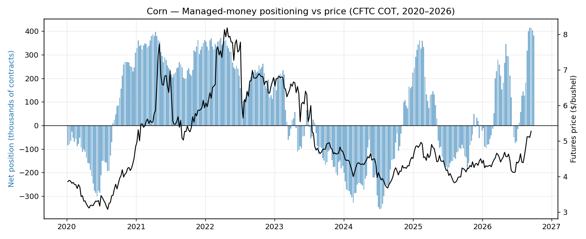
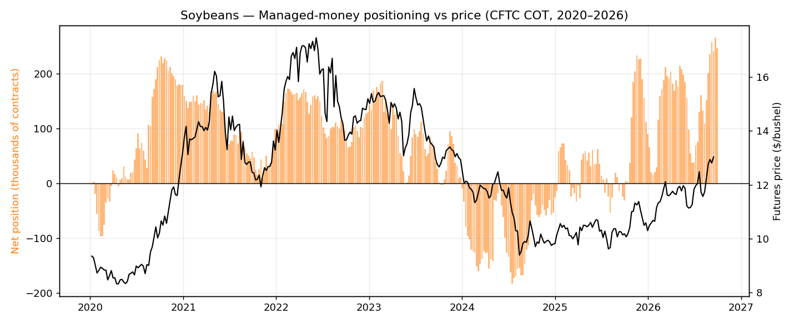

# COT Positioning Tracker — Do Prices Follow the Money?

Weekly CFTC Commitments of Traders (Disaggregated, futures-only) positioning
for CBOT corn and soybeans, **Jan 2020 → Sep 2026 (704 reports)**, plotted
against futures prices. The question: when hedge funds pile in or run for
the exit, what happens to price?

## What it does

| Query | Question it answers |
|---|---|
| `01_current_positioning` | Latest snapshot: managed-money net, commercials net, % of open interest |
| `02_biggest_position_swings` | Largest weekly changes in fund positioning — the rush-in / run-for-exit weeks |
| `03_positioning_vs_price` | Week-by-week dataset behind the charts |

## Key findings (Sep 29, 2026 report)

- **Funds are heavily long both markets:** managed money net +381k corn
  contracts (20.5% of open interest) and +247k soybean contracts (22.6%).
- **Commercials are the mirror image:** net short 733k corn and 291k soybean
  contracts — producers and merchants hedging, as textbook theory predicts.
- **Biggest fund exodus:** corn, week of Feb 28 2023 — funds dumped 151k net
  contracts in a single week.
- **Biggest rush in:** corn, week of Mar 10 2026 — funds added 147k net
  contracts.




## How to run it

```bash
python3 load_cot.py    # unzip CFTC files -> data/cot.db (704 weekly reports)
python3 add_prices.py  # attach a futures close to each report date
sqlite3 data/cot.db < queries/01_current_positioning.sql
```

Raw CFTC zips are in `data/` (redownload from the CFTC Historical Compressed
page if you want newer weeks). Futures prices come from the companion
[corn-soy-futures-sql](https://github.com/josea12345/corn-soy-futures-sql)
project.

## Data sources

- CFTC Disaggregated Commitments of Traders, futures-only
  (`fut_disagg_txt_YYYY.zip`), via cftc.gov
- CBOT corn (`ZC=F`) / soybean (`ZS=F`) daily futures via Yahoo Finance

## Skills demonstrated

Python (data ingestion, zip/CSV parsing, SQLite) · SQL (window functions,
multi-table joins) · futures market structure (managed money vs commercials,
open interest) · data visualization
